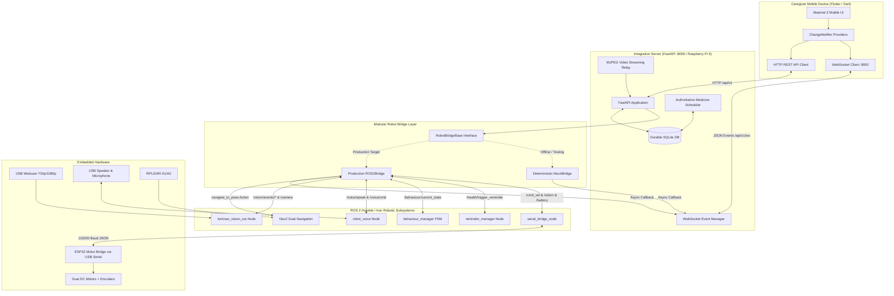

# LUMI System Architecture: Caregiver Mobile Application & ROS 2 Integration

This document outlines the end-to-end software and hardware architecture connecting the **LUMI Caregiver Mobile Application**, the **FastAPI Integration Backend**, and the **ROS 2 Robotic Subsystems**.

---

## 1. System Communication Flow

---

## 2. Network Topology & Security

1. **Local Wi-Fi Network**:
   - The smartphone and Raspberry Pi 5 communicate over the home/facility local area network (LAN).
   - The FastAPI backend binds to `0.0.0.0:8000`.
   - The phone connects directly to `http://<pi-ip-address>:8000`.
   - **No public cloud dependency**: Voice recognition (faster-whisper), LLM generation (Ollama), computer vision (MediaPipe), and navigation (Nav2) run locally on the edge robot.

2. **Security & Authentication**:
   - The mobile application includes an optional `X-API-Key` authentication header configured in **Settings**.
   - Direct ROS 2 DDS network ports and ESP32 serial interfaces are **never** directly exposed to the mobile device.
   - All teleoperation commands are strictly parsed, rate-limited, and speed-clamped by the backend safety layer before publishing to `/cmd_vel`.

---

## 3. Safety Interlocks & Dead-Man Safeguards

1. **Dead-Man Command Velocity Timeout**:
   - Both the backend `safety_interlock` and the ROS 2 `serial_bridge_node` maintain independent watchdogs (`cmd_vel_timeout = 0.5s`).
   - If finger touch ceases on the mobile teleoperation pad, velocity automatically drops to `0.0 m/s`.
   - If Wi-Fi communication drops between the phone and the robot, the robot halts within 500 ms.

2. **Emergency Interlock**:
   - When a fall is detected or an unacknowledged emergency escalates, the behaviour supervisor FSM transitions to `EMERGENCY`.
   - In `EMERGENCY` state, the robot commands immediate zero twist and blocks arbitrary navigation until acknowledged by a verified caregiver.

3. **Speed Limits**:
   - Maximum linear velocity is clamped to **0.35 m/s** (safe indoor walking speed).
   - Maximum angular velocity is clamped to **0.80 rad/s**.

---

## 4. Dual Bridge Architecture

To satisfy development, continuous integration, and production requirements:
- **`MockBridge`**: Implements deterministic, math-accurate simulation of robot kinematics, battery discharge, Nav2 goal movement, camera test patterns, and speech responses. Enabled by default with `--mock` or `LUMI_DEV_MODE=true`.
- **`ROS2Bridge`**: Implements native `rclpy` publishers, subscribers, and action clients directly interfacing with the physical robot topics when running on the Raspberry Pi 5.
