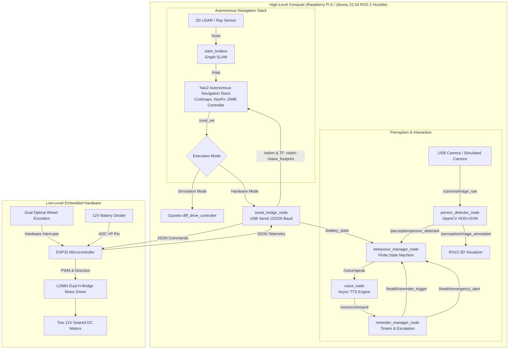

# 00 — LUMI Healthcare Robot: Project Overview & Academic Architecture

```
========================================================================================
Project: LUMI — AI Autonomous Healthcare Companion Robot
Target Environment: Ubuntu 22.04 LTS | ROS 2 Humble Hawksbill | Gazebo Classic 11
Primary Focus: ROS 2 Mobile Robotics, Autonomous Navigation, TF2, SLAM, Hardware Bridge
========================================================================================
```

---

## 1. Executive Summary & Problem Statement

### 1.1 The Healthcare Challenge
Elderly populations and individuals recovering from chronic conditions often live semi-independently or in assisted-care facilities. Key daily challenges include:
1. **Medication Non-Adherence:** Forgetting critical scheduled medicines or failing to confirm ingestion.
2. **Mobility and Isolation:** Inability to summon assistance when distressed or incapacitated.
3. **Delayed Emergency Response:** A fall or medical emergency often goes unmonitored for hours if the individual cannot reach a wall button or phone.

### 1.2 The LUMI Solution
**LUMI** is an Autonomous Mobile Robot (AMR) designed as an indoor healthcare companion. Built on a differential-drive mobile base, LUMI autonomously patrols home environments, maintains a live 2D metric map of the rooms, navigates safely around static and dynamic obstacles, detects human presence using onboard computer vision, provides verbal medicine reminders with escalation timers, and bridges high-level companion intelligence to low-level microcontroller actuators.



---

## 2. Core Architectural Principles

### 2.1 ROS 2 is the Central Nervous System
Rather than writing ad-hoc robotic scripts, LUMI adheres strictly to the **ROS 2 Humble standard**:
- **DDS Middleware (Data Distribution Service):** Enables decentralized, peer-to-peer, discovery-based inter-process communication between nodes without a single point of failure.
- **Node Specialization:** Each node is single-purpose (e.g., `serial_bridge_node` only manages motor communication and odometry; `person_detector_node` only processes frames).
- **Standardized Interfaces:** Uses canonical ROS 2 message definitions (`geometry_msgs/msg/Twist`, `nav_msgs/msg/Odometry`, `sensor_msgs/msg/LaserScan`, `sensor_msgs/msg/Image`, `sensor_msgs/msg/BatteryState`).
- **TF2 Dynamic Transform Tree:** Maintains the coordinate frame hierarchy relating sensor origins, wheels, and ground projection to the world frame.

### 2.2 Strict Physical Hardware Realism (No Manipulators / Arms)
> [!IMPORTANT]
> **LUMI DOES NOT HAVE A ROBOTIC ARM.**
> Academic projects frequently fail by over-promising manipulation. LUMI's physical hardware contract is a robust **differential-drive mobile platform** (2 driving wheels + 1 balancing caster). All companion interactions are delivered through mobility, perception, display, and voice synthesis.

---

## 3. Subsystem Roles and Technologies

### 3.1 ROS 2 Humble Hawksbill
- **Host OS:** Ubuntu 22.04 LTS (x86_64 for workstations, aarch64 for Raspberry Pi 5).
- **Role:** Communication bus, parameter server, execution model (single-threaded and multi-threaded executors), and process lifecycle management.

### 3.2 Gazebo Classic 11 & RViz2
- **Gazebo Classic 11:** Physics engine simulating rigid-body dynamics, inertia matrices, gravity, ground contact friction, sensor ray-casting for LiDAR, and camera optics.
- **RViz2:** State visualization tool displaying the robot's URDF model, coordinate transforms (`/tf`), laser pointclouds, costmap grids, particle filter clouds, and path trajectories.
- **Key Viva Distinction:** Gazebo *simulates reality*; RViz2 *visualizes what the robot's software perceives*.

### 3.3 SLAM Toolbox, Nav2, and AMCL
- **SLAM Toolbox:** Pose-graph SLAM algorithm performing scan matching, loop closure detection, and incremental occupancy grid generation on `/map`.
- **Nav2 Stack:** High-level autonomous navigation engine:
  - **Global Planner (NavFn):** Calculates shortest collision-free paths across the global costmap using Dijkstra / A* search.
  - **Local Controller (DWB Local Planner):** Evaluates forward trajectory rollouts factoring in kinematic velocity/acceleration limits and obstacle inflation cost.
  - **Behavior Server & BT Navigator:** Behavior-tree orchestrator managing recoveries (spin, backup, wait) if the robot is blocked.
- **AMCL (Adaptive Monte Carlo Localization):** Probabilistic localization matching live LiDAR scans to a pre-recorded static map using a KLD-sampling particle filter.

### 3.4 Dual-Tier Compute Architecture: Raspberry Pi 5 + ESP32
| Feature | Raspberry Pi 5 | ESP32-WROOM-32 |
| :--- | :--- | :--- |
| **Operating System** | Ubuntu 22.04 LTS Linux | Bare-metal FreeRTOS / Arduino Core |
| **Timing Characteristic** | General-purpose OS (non-deterministic latency) | Hard real-time deterministic microsecond execution |
| **Responsibilities** | ROS 2 stack, SLAM, Nav2, Computer Vision, Voice | High-frequency PWM generation (20 kHz), encoder ISRs, ADC |
| **Inter-Processor Link** | USB Serial CDC at 115200 Baud with newline-delimited JSON packets |

---

## 4. Implementation vs. Planned Scope

| Subsystem | Implemented & Code-Verified | Verification Status | Hardware/Sim Status |
| :--- | :--- | :--- | :--- |
| **Robot Description (URDF/Xacro)** | Parametric chassis, wheels, caster, sensors, inertias | Verified via XML parser & ROS test suite | Validated in Gazebo & RViz2 |
| **Gazebo World & Plugins** | Room world, diff-drive, ray laser, camera plugins | Verified via XML & launch descriptors | Ready for Ubuntu Gazebo 11 |
| **Differential-Drive Kinematics** | Forward & inverse kinematics, quaternion conversions | Fully unit tested (100% pass) | Shared math between Sim & ESP32 |
| **ESP32 Serial Bridge & Odometry** | JSON serial bridge, encoder tick integration, watchdog | Fully unit tested (100% pass) | Tested in loopback; ready for hardware port |
| **ESP32 Firmware** | 20 kHz LEDC PWM, interrupt ISRs, JSON parser, watchdog | Audited C++ source code | Ready for PlatformIO / Arduino IDE flashing |
| **SLAM Toolbox Integration** | `slam_toolbox_params.yaml`, `slam.launch.py` | Validated YAML & Launch | Ready for ROS 2 Humble execution |
| **Nav2 Autonomous Navigation** | `nav2_params.yaml`, DWB controller, costmaps | Validated YAML & Launch | Configured for differential drive |
| **Computer Vision Perception** | OpenCV HOG+SVM person detection, distance estimation | Fully unit tested & verified | Tested with synthetic frames & webcam node |
| **Voice Synthesis** | Async background worker thread, pyttsx3 offline TTS | Verified with non-blocking queue | Hardware audio speaker or console fallback |
| **Healthcare Reminders** | Timers, escalation alerts, Trigger ROS 2 services | Fully unit tested (100% pass) | Code implemented & verified |
| **Behaviour Manager FSM** | 5-state supervisor (IDLE, NAV, INTERACT, REMIND, EMERG) | Fully unit tested (100% pass) | Code implemented & verified |
| **Master System Bringup** | `bringup_full_system.launch.py` with sim/hardware flags | Verified launch architecture | One-command system launch |
