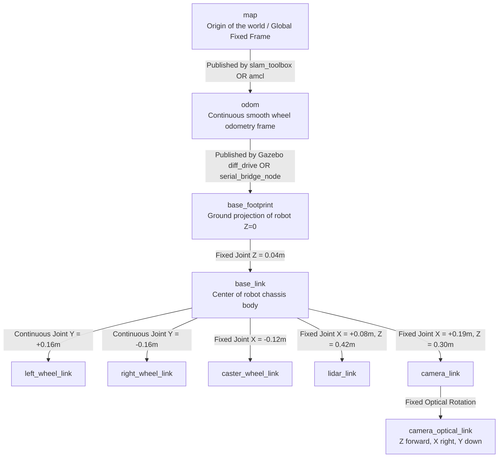

# 02 — ROS 2 Node, Topic, Service & Action Interface Map

```
========================================================================================
Project: LUMI — AI Autonomous Healthcare Companion Robot
Target Environment: Ubuntu 22.04 LTS | ROS 2 Humble Hawksbill
Standard: Exact interface contract derived from authored source code and configurations.
========================================================================================
```

---

## 1. Complete ROS 2 Node Registry

| Node Name | Package Name | Executable Name | Source File Path | Main Responsibility | Launched By |
| :--- | :--- | :--- | :--- | :--- | :--- |
| `robot_state_publisher` | `robot_state_publisher` | `robot_state_publisher` | ROS 2 Core Binary | Computes link coordinate transforms from URDF and broadcasts `/tf` and `/tf_static`. | `gazebo_sim.launch.py`, `bringup_full_system.launch.py` |
| `spawn_entity` | `gazebo_ros` | `spawn_entity.py` | `gazebo_ros/spawn_entity.py` | Service client that injects robot URDF XML into Gazebo Classic physics simulation. | `gazebo_sim.launch.py` |
| `serial_bridge_node` | `robot_hardware` | `serial_bridge_node` | `robot_ws/src/robot_hardware/robot_hardware/serial_bridge_node.py` | Translates `/cmd_vel` to ESP32 JSON, parses encoder ticks, integrates odometry, broadcasts TF `odom->base_footprint`. | `bringup_full_system.launch.py` (`use_sim:=false`) |
| `person_detector_node` | `robot_perception` | `person_detector_node` | `robot_ws/src/robot_perception/robot_perception/person_detector_node.py` | Runs OpenCV HOG+SVM on camera images, outputs detection bool, count, and distance estimation. | `bringup_full_system.launch.py` |
| `webcam_publisher_node` | `robot_perception` | `webcam_publisher_node` | `robot_ws/src/robot_perception/robot_perception/webcam_publisher_node.py` | Captures physical USB webcam frames via V4L2/OpenCV and publishes `/camera/image_raw`. | Standalone hardware test / camera launch |
| `voice_node` | `robot_voice` | `voice_node` | `robot_ws/src/robot_voice/robot_voice/voice_node.py` | Offline text-to-speech engine using a background worker thread so ROS callbacks never block. | `bringup_full_system.launch.py` |
| `reminder_manager_node` | `robot_health` | `reminder_manager_node` | `robot_ws/src/robot_health/robot_health/reminder_manager_node.py` | Manages scheduled medicine reminders, handles patient voice acknowledgments, and escalates emergencies. | `bringup_full_system.launch.py` |
| `behaviour_manager_node` | `robot_behaviour` | `behaviour_manager_node` | `robot_ws/src/robot_behaviour/robot_behaviour/behaviour_manager_node.py` | 5-state supervisor Finite State Machine. Coordinates greetings, alerts, and emergency stop actions. | `bringup_full_system.launch.py` |
| `slam_toolbox` | `slam_toolbox` | `async_slam_toolbox_node` | ROS 2 Binary | Performs 2D pose-graph SLAM, loop closure, and publishes live dynamic `/map`. | `slam.launch.py`, `full_navigation.launch.py` |
| `rviz2` | `rviz2` | `rviz2` | ROS 2 Core Binary | 3D state, laser scan, map, costmap, and trajectory visualizer. | `gazebo_sim.launch.py`, `bringup_full_system.launch.py` |

---

## 2. Topic Communication Matrix

| Topic Name | Message Type | Publisher Node(s) | Subscriber Node(s) | Update Rate | Purpose & Inspection Command |
| :--- | :--- | :--- | :--- | :--- | :--- |
| `/cmd_vel` | `geometry_msgs/msg/Twist` | `Nav2 controller_server`, `behaviour_manager_node`, or `teleop_twist_keyboard` | `serial_bridge_node` (Hardware) OR `diff_drive_controller` (Gazebo) | 10–20 Hz | Target linear ($v_x$) and angular ($\omega_z$) velocity.<br/>`ros2 topic echo /cmd_vel` |
| `/odom` | `nav_msgs/msg/Odometry` | `diff_drive_controller` (Sim) OR `serial_bridge_node` (Hardware) | `Nav2`, `slam_toolbox`, `rviz2` | 20 Hz | Estimated robot pose $(x, y, \theta)$ and velocities from wheel kinematics.<br/>`ros2 topic echo /odom` |
| `/scan` | `sensor_msgs/msg/LaserScan` | `lidar_plugin` (Gazebo) OR RPLiDAR Driver (Hardware) | `slam_toolbox`, `Nav2 costmaps`, `rviz2` | 10 Hz | 360-degree planar range distance measurements.<br/>`ros2 topic hz /scan` |
| `/camera/image_raw` | `sensor_msgs/msg/Image` | `camera_plugin` (Gazebo) OR `webcam_publisher_node` | `person_detector_node`, `rviz2` | 30 Hz | Raw RGB video stream from front camera.<br/>`ros2 topic hz /camera/image_raw` |
| `/camera/camera_info` | `sensor_msgs/msg/CameraInfo` | `camera_plugin` (Gazebo) OR `webcam_publisher_node` | Image pipelines, calibration nodes | 30 Hz | Camera intrinsic parameters (focal length, optical center). |
| `/perception/person_detected` | `std_msgs/msg/Bool` | `person_detector_node` | `behaviour_manager_node` | ~15–30 Hz | `True` when at least one human is detected in camera FOV.<br/>`ros2 topic echo /perception/person_detected` |
| `/perception/person_count` | `std_msgs/msg/Int32` | `person_detector_node` | Telemetry / GUI | ~15–30 Hz | Total number of detected human bounding boxes. |
| `/perception/detections` | `std_msgs/msg/String` | `person_detector_node` | Companion logic / Diagnostics | ~15–30 Hz | JSON payload containing bounding boxes, bearing, and distance.<br/>`ros2 topic echo /perception/detections` |
| `/perception/image_annotated` | `sensor_msgs/msg/Image` | `person_detector_node` | `rviz2`, Web dashboard | ~15–30 Hz | Processed camera frame with green bounding boxes and distance tags. |
| `/voice/speak` | `std_msgs/msg/String` | `reminder_manager_node`, `behaviour_manager_node` | `voice_node` | Event-driven | Text string to be rendered via offline TTS voice engine.<br/>`ros2 topic echo /voice/speak` |
| `/voice/command` | `std_msgs/msg/String` | `voice_node` (Microphone parser) or manual terminal input | `reminder_manager_node`, `behaviour_manager_node` | Event-driven | Recognized speech keywords ("stop", "medicine", "confirm").<br/>`ros2 topic pub /voice/command std_msgs/msg/String "{data: 'medicine'}"` |
| `/health/reminder_trigger` | `std_msgs/msg/String` | `reminder_manager_node` | `behaviour_manager_node` | Periodic (60s default) | Event announcing that a scheduled medication alarm fired. |
| `/health/emergency_alert` | `std_msgs/msg/String` | `reminder_manager_node` | `behaviour_manager_node` | Event-driven | Escalated warning when medication is unacknowledged after 30s. |
| `/health/reminder_pending` | `std_msgs/msg/Bool` | `reminder_manager_node` | GUI / Caregiver Bridge | Periodic / Event | Boolean state indicating if a reminder is currently awaiting ack. |
| `/behaviour/current_state` | `std_msgs/msg/String` | `behaviour_manager_node` | System supervisor / RViz2 overlay | 10 Hz | Current FSM state: `IDLE`, `NAVIGATING`, `INTERACTING`, `REMINDER`, `EMERGENCY`. |
| `/battery_state` | `sensor_msgs/msg/BatteryState` | `serial_bridge_node` | System status monitor | 20 Hz | Voltage and estimated remaining battery capacity from ESP32 ADC. |
| `/map` | `nav_msgs/msg/OccupancyGrid` | `slam_toolbox` (Mapping) OR `map_server` (Localization) | `Nav2 global_costmap`, `rviz2` | 1–2 Hz | 2D occupancy grid where 0 = free, 100 = occupied, -1 = unknown. |
| `/tf` & `/tf_static` | `tf2_msgs/msg/TFMessage` | `robot_state_publisher`, `diff_drive_controller` / `serial_bridge_node`, `slam_toolbox` | All navigation nodes, `rviz2` | Continuous | Dynamic and static coordinate transformations between frames. |

---

## 3. Services and Actions Registry

### 3.1 ROS 2 Services
| Service Name | Service Type | Server Node | Client Node / Trigger | Purpose |
| :--- | :--- | :--- | :--- | :--- |
| `/health/trigger_reminder` | `std_srvs/srv/Trigger` | `reminder_manager_node` | Caregiver app or terminal | Triggers an immediate medication reminder on demand.<br/>`ros2 service call /health/trigger_reminder std_srvs/srv/Trigger` |
| `/health/acknowledge_reminder` | `std_srvs/srv/Trigger` | `reminder_manager_node` | Companion button or terminal | Acknowledges active medication reminder programmatically without voice.<br/>`ros2 service call /health/acknowledge_reminder std_srvs/srv/Trigger` |
| `/behaviour/reset_state` | `std_srvs/srv/Trigger` | `behaviour_manager_node` | Caregiver supervisor | Clears emergency or interacting states and resets FSM to `IDLE`.<br/>`ros2 service call /behaviour/reset_state std_srvs/srv/Trigger` |
| `/slam_toolbox/save_map` | `slam_toolbox/srv/SaveMap` | `slam_toolbox` | Terminal operator | Saves the active SLAM map to disk.<br/>`ros2 service call /slam_toolbox/save_map slam_toolbox/srv/SaveMap "{name: {data: 'my_map'}}"` |

### 3.2 ROS 2 Actions
| Action Name | Action Type | Action Server Node | Action Client Node | Purpose |
| :--- | :--- | :--- | :--- | :--- |
| `/navigate_to_pose` | `nav2_msgs/action/NavigateToPose` | `bt_navigator` | RViz2 "2D Nav Goal" or application logic | Autonomous goal navigation with continuous feedback and cancelability. |
| `/follow_path` | `nav2_msgs/action/FollowPath` | `controller_server` (DWB) | `bt_navigator` | Follows path waypoints produced by global planner. |
| `/compute_path_to_pose`| `nav2_msgs/action/ComputePathToPose` | `planner_server` (NavFn) | `bt_navigator` | Computes geometric collision-free A* path. |

---

## 4. Coordinate Transforms (TF2 Tree) Architecture



### Critical Viva Principle: Preventing Duplicate Transform Publishers
- **In Simulation (`use_sim:=true`):** Gazebo's `diff_drive_controller` plugin publishes `odom -> base_footprint`. The `serial_bridge_node` is NOT launched.
- **On Physical Hardware (`use_sim:=false`):** `serial_bridge_node` computes odometry from ESP32 encoder ticks and publishes `odom -> base_footprint`. Gazebo is NOT running.
- **Result:** There is **never** a race condition or duplicate publisher for the `odom -> base_footprint` transform!

---

## 5. Core ROS 2 Communication Concepts Explained for Oral Defense

### 5.1 Topics vs. Services vs. Actions
- **Topics (Publish/Subscribe):** Unidirectional, many-to-many, asynchronous data streaming (e.g., continuous 20 Hz sensor data on `/scan` or velocities on `/cmd_vel`). Publishers do not wait for subscribers.
- **Services (Request/Response):** Synchronous, two-way, client-server transactions for discrete tasks (e.g., `/health/trigger_reminder` or `/slam_toolbox/save_map`). Client blocks or awaits a future until the server returns success/failure.
- **Actions (Goal/Feedback/Result):** Asynchronous, long-running, preemptible goal tasks with progress feedback (e.g., `/navigate_to_pose`). The client can monitor distance-to-goal and cancel the navigation task halfway through if needed.

### 5.2 Quality of Service (QoS) Policies
- **Sensor Data (LiDAR / Camera):** Set to `Best Effort` reliability and `Volatile` durability with small history depth. If network latency drops a frame, discarding it is better than choking the network with stale sensor readings.
- **Command & Telemetry (`/cmd_vel`, `/odom`):** Set to `Reliable` so speed commands and position updates are guaranteed delivery.
- **Static Maps (`/map`):** Set to `Transient Local` durability. Late-joining nodes (like an RViz2 instance launched after SLAM has already started) immediately receive the last published map without waiting for a re-publish.
