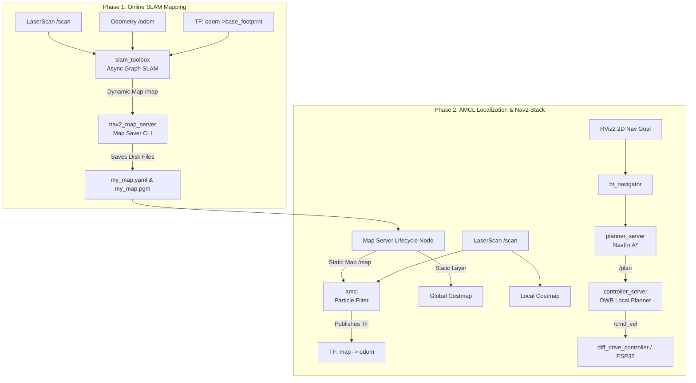

# 05 — SLAM, Nav2, Gazebo & RViz2 Complete Simulation Workflow

```
========================================================================================
Project: LUMI — AI Autonomous Healthcare Companion Robot
Target Environment: Ubuntu 22.04 LTS | ROS 2 Humble Hawksbill
Workflow: 2D Mapping -> Map Saving -> AMCL Localization -> Autonomous Navigation
========================================================================================
```

---

## 1. High-Level Navigation Architecture Overview



---

## 2. Step-by-Step Simulation Execution Instructions

### Step 1: Launch Gazebo Simulation World & Robot
Open Terminal 1:
```bash
# Source ROS 2 Humble and workspace overlay
source /opt/ros/humble/setup.bash
source ~/luminax/robot_ws/install/setup.bash

# Launch Gazebo Classic 11 with healthcare room and LUMI robot
ros2 launch robot_simulation gazebo_sim.launch.py
```
*Verification:*
- Gazebo window opens displaying the room with pillars, table, and perimeter walls.
- LUMI appears at origin `(0, 0, 0.05)` and settles onto its drive wheels and rear caster.
- Check active topics in a new terminal:
  ```bash
  ros2 topic list
  ```
  Expected core topics: `/cmd_vel`, `/odom`, `/scan`, `/camera/image_raw`, `/tf`, `/tf_static`.

---

### Step 2: Verify Sensor Streams & Coordinate Transforms (TF)
Run the following verification commands:
```bash
# 1. Check LiDAR update rate (should be ~10 Hz)
ros2 topic hz /scan

# 2. Check Odometry update rate (should be ~20 Hz)
ros2 topic hz /odom

# 3. Inspect TF Tree
ros2 run tf2_tools view_frames
# Generates frames.pdf. Verify single tree: map -> odom -> base_footprint -> base_link -> links
```

---

### Step 3: Online SLAM Mapping Workflow
Open Terminal 2:
```bash
source /opt/ros/humble/setup.bash
source ~/luminax/robot_ws/install/setup.bash

# Start SLAM Toolbox in online mapping mode
ros2 launch robot_navigation slam.launch.py use_sim_time:=true
```

Open Terminal 3 (RViz2 Visualizer):
```bash
source /opt/ros/humble/setup.bash
source ~/luminax/robot_ws/install/setup.bash

# Launch RViz2 loaded with the pre-configured navigation configuration
rviz2 -d ~/luminax/robot_ws/install/robot_navigation/share/robot_navigation/rviz/navigation.rviz
```

Open Terminal 4 (Keyboard Teleoperation):
```bash
source /opt/ros/humble/setup.bash

# Drive LUMI through the room to map obstacles
ros2 run teleop_twist_keyboard teleop_twist_keyboard
```
*Keys:*
- `i`: Move forward (press a few times to set moderate speed ~0.2 m/s).
- `j` / `l`: Turn left / right.
- `k`: Stop.
- Drive the robot slowly along all four walls and around the center obstacles until RViz displays closed, clear room contours.

---

### Step 4: Saving the Generated Map to Disk
Once mapping is complete, open Terminal 5 and save the occupancy grid:
```bash
source /opt/ros/humble/setup.bash

# Navigate to maps directory
cd ~/luminax/robot_ws/src/robot_navigation/maps

# Save map using Nav2 Map Saver CLI
ros2 run nav2_map_server map_saver_cli -f hospital_room_map
```
*Generated Artifacts:*
1. `hospital_room_map.pgm`: 2D grayscale image (black = wall obstacle, white = free space, gray = unexplored).
2. `hospital_room_map.yaml`: Metadata file containing image filename, resolution (`0.05`), origin `[-10.0, -10.0, 0.0]`, and occupancy thresholds.

---

### Step 5: Autonomous Navigation Stack (Nav2 + AMCL)
Now switch from SLAM mapping mode to static-map autonomous navigation.
Close SLAM Toolbox (`Ctrl+C` in Terminal 2).

In Terminal 2, launch Nav2 with the saved map:
```bash
source /opt/ros/humble/setup.bash
source ~/luminax/robot_ws/install/setup.bash

ros2 launch robot_navigation navigation.launch.py \
    map:=$HOME/luminax/robot_ws/src/robot_navigation/maps/hospital_room_map.yaml \
    use_sim_time:=true
```

In RViz2:
1. Select the **2D Pose Estimate** button on the top toolbar. Click and drag on the map at the robot's approximate location in Gazebo to initialize AMCL particle cloud.
2. Observe the yellow AMCL arrow cluster converge around the robot footprint.
3. Select the **2D Goal Pose** button on the toolbar. Click and drag anywhere in open white space in the room.
4. **Autonomous Execution:**
   - NavFn calculates a green path line (`/plan`).
   - DWB controller computes dynamic window velocity rollouts (`/local_plan`).
   - Robot moves autonomously along the path while dynamically swerving to avoid obstacles!

---

## 3. Core Robotics Concepts Explained for Oral Defense

### 3.1 Mapping vs. Localization vs. Navigation
- **Mapping (SLAM):** Robot knows neither where it is nor what the environment looks like. It solves the chicken-and-egg problem: building a map while simultaneously estimating its pose inside that map.
- **Localization (AMCL):** Robot is given a known static map. It uses a particle filter to find its $(x, y, \theta)$ position by comparing live LiDAR scan points with expected obstacle coordinates on the map.
- **Global Path Planning (NavFn):** High-level A* algorithm treating the robot as a point mass on the 2D grid to compute the shortest geometric path to the goal.
- **Local Trajectory Control (DWB):** Low-level controller evaluating dynamic acceleration limits, wheel velocity constraints, and obstacle proximity to generate actual `/cmd_vel` motor commands.

### 3.2 Global Costmap vs. Local Costmap
- **Global Costmap:** Spans the entire static map. Built from static map layer + obstacle layer + inflation layer. Used by the global planner to plot cross-room paths.
- **Local Costmap:** Rolling window (e.g., $3\,\text{m} \times 3\,\text{m}$) centered dynamically on the robot's `base_footprint`. Updates at 5 Hz from live LiDAR rays. Used by DWB local planner to avoid moving objects or unmapped obstacles.

---

## 4. Troubleshooting Common Failures

| Symptom / Error | Likely Root Cause | Diagnostic & Corrective Command |
| :--- | :--- | :--- |
| **"Waiting for map..." in RViz** | `map_server` lifecycle node not activated or SLAM not running. | Run `ros2 lifecycle get /map_server`. In `navigation.launch.py`, ensure `autostart:=true`. |
| **Robot spinning in circles endlessly** | Laser scan reversed ($180^\circ$ yaw) or DWB critics misconfigured. | Check `healthcare_robot.urdf.xacro` lidar joint origin `rpy`. Verify scan orientation matches motion in RViz. |
| **AMCL particles do not converge** | Wheel odometry drifting severely or `odom_frame` mismatch. | Inspect `ros2 topic echo /odom`. Check that wheel track separation ($0.32\,\text{m}$) in URDF matches parameter. |
| **Transform timeout / TF extrapolation** | `use_sim_time` set to `false` while running Gazebo simulation. | Pass `use_sim_time:=true` to all launch files when running against Gazebo. |
